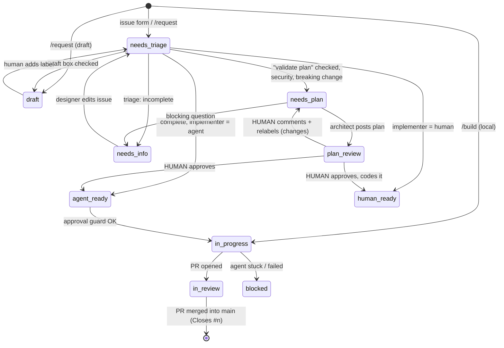

# Agentic workflow

Two ways to ship a change, same rules (`CLAUDE.md`), same PR review:

| Path            | Who codes                                   | Entry                                  |
| --------------- | ------------------------------------------- | -------------------------------------- |
| **CI agents**   | Claude in GitHub Actions                    | an issue (`/request` or an issue form) |
| **Local build** | The designer + Claude Code on their machine | `/build`                               |

Content (projects, pages, media, site settings) needs neither: it is edited in the Payload admin. A _new kind_ of content (new collection, new fields, new block) is a feature.

## CI path

Issues move through `status:*` labels. Adding a label fires a GitHub Actions job that runs a Claude agent ([claude-code-action](https://github.com/anthropics/claude-code-action)). Agents change labels, which fires the next job. Humans approve plans and merge.

### 1. Intake — need → issue

- **Claude Code — `/request`** (`.claude/agents/intake.md`, also `claude --agent intake`): guided questions from `docs/intake-questions.md`, clickable choices where possible, in French; shows the draft, asks the options, then `gh issue create`.
- **GitHub issue forms** (`.github/ISSUE_TEMPLATE/`, in French): one per type, plus **« Avec mes mots »**: a free prompt the triage agent formats.

Every issue ends with the options `Validate plan before dev`, `Draft: don't start agents yet`, and `Implementer: agent | human`.

| Create without starting agents             | Result                                                       |
| ------------------------------------------ | ------------------------------------------------------------ |
| Form with **Draft** box checked            | Triage job unchecks it, sets `status:draft` (no Claude call) |
| `/request` → "Keep as draft"               | Created with `status:draft`                                  |
| `gh issue create` with no `status:*` label | Nothing runs                                                 |

Start later: add `status:needs-triage`. Stop a running flow: set `status:human-ready` or `status:draft`.

### 2. Triage — validate, format, route

Job `triage` in `.github/workflows/agent-issue.yml`, instructions `.claude/agents/triage.md`. Adds `type:*`, rewrites free text into `docs/issue-format.md` (original kept, nothing invented), checks the checklist. Missing info → questions + `status:needs-info`; **the designer answers by editing the issue**, which re-runs triage (job `retriage`). Otherwise routes to `needs-plan`, `human-ready`, or `agent-ready`.

### 3. Plan — architect writes, human validates

Job `plan`, instructions `.claude/agents/architect.md`. Posts `<!-- agent:plan vN -->` and sets `status:plan-review`.

| Human wants          | Action                                                                              |
| -------------------- | ----------------------------------------------------------------------------------- |
| Approve, agent codes | Tick **Approve plan and start dev** in the latest plan, or add `status:agent-ready` |
| Approve, human codes | Add `status:human-ready` (then `/build` locally, or code it)                        |
| Changes              | Comment, then add `status:needs-plan` → architect posts `vN+1`                      |

The **approval guard** in job `develop`: label/box by a human → must have write access; box → only on the latest plan while `plan-review`; label by a bot → refused if a plan exists, if plan validation was requested, or if the author isn't a repo member. Agents never approve their own plan.

### 4. Develop — agent implements, opens PR

Job `develop`, instructions `.claude/agents/developer.md`. Branches from `main` (`feat/42-contact-form`), implements with **ponytail**, runs `pnpm lint && pnpm typecheck && pnpm test` until green, opens one PR into `main` with `Closes #42`, waits for the Vercel preview build (`gh pr checks`), sets `in-review`. Stuck → comment + `status:blocked`.

Iterate on any PR or issue by commenting `@claude <request>` (`agent-mention.yml`, writers only).

## Local path — `/build`

`.claude/agents/designer.md`, started with `/build` (or `claude --agent designer`). For the designer, in French, no git knowledge needed:

1. Picks an existing issue, or creates one with the intake questions (label `status:in-progress`, so no CI agent picks it up).
2. Checks the machine (Node, `.env`, database), branches from up-to-date `main`.
3. Proposes a short plan in plain words, gets a yes, implements, runs `pnpm dev` and asks the designer to look at `http://localhost:3000`. Iterates on feedback.
4. Runs every check, commits, pushes, opens the PR (`Closes #n`), sets `status:in-review`, gives the PR and Vercel preview links.

## PR review — auto-merge or human

`.github/workflows/agent-pr.yml`, on every push to a PR into `main` (both paths):

1. **Reset**: removes `pr:*` labels, disables auto-merge.
2. **Hard gate** (`.github/scripts/pr-gate.sh`, deterministic): ≤ 80 changed lines, ≤ 8 files, no sensitive path (content model, access, Payload config/admin, cache layer, env, `.github/`, `.claude/`, deps, config files), no `security`/`breaking-change`, no `!` in title.
3. **Reviewer agent** (`.claude/agents/pr-reviewer.md`): correctness, caching rules, security, accessibility, tests, over-engineering; one comment; `pr:auto-merge` only if the gate said `eligible` **and** no finding **and** obviously safe. Else `pr:human-review`.
4. **`review-gate`** check: passes with a human approval on the head commit, or `pr:auto-merge` + hard gate re-checked.
5. `pr:auto-merge` → merge (squash) once `ci` + `pr-meta` + the Vercel preview build are green. Merge to `main` = production deploy.

## Agents summary

| Agent       | Trigger               | Instructions                    | Model (repo var → default)                  | Can                                        |
| ----------- | --------------------- | ------------------------------- | ------------------------------------------- | ------------------------------------------ |
| Intake      | `/request` (local)    | `.claude/agents/intake.md`      | session model                               | ask questions, create issue                |
| Designer    | `/build` (local)      | `.claude/agents/designer.md`    | session model                               | edit code, run dev server, git, open PR    |
| Triage      | `status:needs-triage` | `.claude/agents/triage.md`      | `CLAUDE_MODEL_TRIAGE` → `claude-sonnet-5-5` | read repo, edit issue, comment, set status |
| Architect   | `status:needs-plan`   | `.claude/agents/architect.md`   | `CLAUDE_MODEL_PLAN` → `claude-sonnet-5-5`   | read repo, comment, set status             |
| Developer   | `status:agent-ready`  | `.claude/agents/developer.md`   | `CLAUDE_MODEL_DEV` → `claude-sonnet-5-5`    | edit code, pnpm, git, open PR              |
| PR reviewer | PR push into main     | `.claude/agents/pr-reviewer.md` | `CLAUDE_MODEL_REVIEW` → `claude-sonnet-5-5` | read diff, comment, label PR               |
| Mention     | `@claude` comment     | —                               | `CLAUDE_MODEL_DEV`                          | edit code on the PR                        |

Skills available to every agent: **payload** (`.claude/skills/payload`, Payload reference) and **ponytail** (plugin: CI `plugins` input, locally `.claude/settings.json`).

## Security model

- **Event chaining** uses a dedicated GitHub App token (`GITHUB_TOKEN` events don't trigger workflows).
- **Tools allow-listed per agent** (`--allowedTools`). Triage/architect can't edit code; reviewer can't push.
- **Untrusted text**: issue and PR content is data. Hard limits (approval guard, hard gate) don't rely on the model obeying.
- **PR workflows check out the base branch** for scripts and agent instructions: a PR cannot rewrite its own gate.
- CI agents never get production secrets: GitHub Actions has no database access at all (placeholder env); the only build is Vercel's preview, against the preview database.
- The developer agent runs `pnpm` scripts (= arbitrary code) with the App token. Keep the repo **private**.

## When something goes wrong

| Symptom                            | Fix                                                                                                     |
| ---------------------------------- | ------------------------------------------------------------------------------------------------------- |
| Issue stuck in `status:blocked`    | Read the agent's comment / run link, fix the issue, re-add the previous status label                    |
| Triage didn't start                | Remove and re-add `status:needs-triage`                                                                 |
| PR stuck "review-gate expected"    | Classification still running or failed: re-run `agent-pr` or approve the PR                             |
| Agent opened a bad PR              | Close it, comment on the issue, add `status:needs-plan` or `status:agent-ready` again                   |
| Content saved but site not updated | Check the doc is **published**; check the model component tags what it renders (`docs/architecture.md`) |
