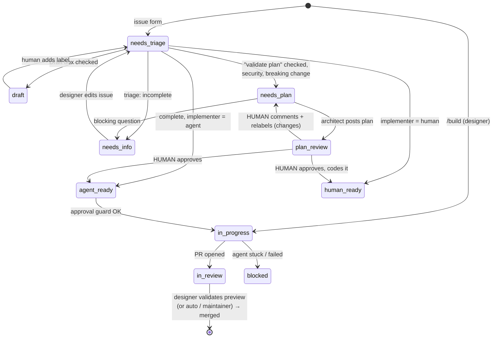

# Agentic workflow

Two ways to ship a change, same rules (`CLAUDE.md`), same PR review:

| Path            | Who codes                                   | Entry                                  |
| --------------- | ------------------------------------------- | -------------------------------------- |
| **CI agents** | Claude in GitHub Actions | an issue from a maintainer (issue form) |
| **`/build`** | Claude Code on the designer's machine, iterating with them on the Vercel preview | the designer, in conversation (never on github.com) |

Content (projects, pages, media, site settings) needs neither: it is edited in the Payload admin. A _new kind_ of content (new collection, new fields, new block) is a feature.

## CI path

Issues move through `status:*` labels. Adding a label fires a GitHub Actions job that runs a Claude agent ([claude-code-action](https://github.com/anthropics/claude-code-action)). Agents change labels, which fires the next job. Humans approve plans and merge.

### 1. Intake — issue forms

Maintainers open issues with the GitHub issue forms (`.github/ISSUE_TEMPLATE/`, in French): one per type, plus **« Avec mes mots »**, a free prompt the triage agent formats. The designer doesn't use them: `/build` creates their issues.

Every issue ends with the options `Validate plan before dev`, `Draft: don't start agents yet`, and `Implementer: agent | human`.

| Create without starting agents | Result |
|---|---|
| Form with **Draft** box checked | Triage job unchecks it, sets `status:draft` (no Claude call) |
| `gh issue create` with no `status:*` label | Nothing runs |

Start later: add `status:needs-triage`. Stop a running flow: set `status:human-ready` or `status:draft`.

### 2. Triage — validate, format, route

Job `triage` in `.github/workflows/agent-issue.yml`, instructions `.claude/agents/triage.md`. Adds `type:*`, rewrites free text into `docs/issue-format.md` (original kept, nothing invented), checks the checklist. Missing info → questions + `status:needs-info`; **the designer answers by editing the issue**, which re-runs triage (job `retriage`). Otherwise routes to `needs-plan`, `human-ready`, or `agent-ready`.

### 3. Plan — architect writes, human validates

Job `plan`, instructions `.claude/agents/architect.md`. Posts `<!-- agent:plan vN -->` and sets `status:plan-review`.

| Human wants          | Action                                                                              |
| -------------------- | ----------------------------------------------------------------------------------- |
| Approve, agent codes | Tick **Approve plan and start dev** in the latest plan, or add `status:agent-ready` |
| Approve, human codes | Add `status:human-ready` (then `/build` locally, or code it)                        |
| Changes              | Comment, then add `status:needs-plan` → architect posts `vN+1`                      |

The **approval guard** in job `develop`: label/box by a human → must have write access; box → only on the latest plan while `plan-review`; label by a bot → refused if a plan exists, if plan validation was requested, or if the author isn't a repo member. Agents never approve their own plan.

### 4. Develop — agent implements, opens PR

Job `develop`, instructions `.claude/agents/developer.md`. Branches from `main` (`feat/42-contact-form`), implements with **ponytail**, runs `pnpm lint && pnpm typecheck && pnpm test` until green, opens one PR into `main` with `Closes #42`, waits for the Vercel preview build (`gh pr checks`), sets `in-review`. Stuck → comment + `status:blocked`.

Iterate on any PR or issue by commenting `@claude <request>` (`agent-mention.yml`, writers only).

## Design files

The designer can attach a design (zip exported from a design tool or Claude, HTML page, PNG, PDF) to any request. Never mandatory.

- `/build` asks for it (question D1), reads it to skip questions it answers, and stores it with `scripts/add-design.sh` in `designs/<n>-<slug>/` on the feature branch, committed. The issue gets a `### Design files` section.
- The developer agent (or `/build`) works **on that branch**, so the reference ships in the PR next to the implementation, and the reviewer checks the result against it.
- Issue forms accept screenshots and links; zip/HTML go through Claude Code.
- `designs/` is excluded from lint, TypeScript, Tailwind scanning and the PR size limits. Files are references: agents read them, never execute them. Max 25 MB per issue.

## Designer path — `/build`

`.claude/agents/designer.md`, started with `/build` (or `claude --agent designer`). The designer's only entry point, in French. They never open github.com: their `gh` is logged in as them once at setup, and Claude does every GitHub action on their behalf. No `.env` or database on their machine.

1. **Need**: questions from `docs/intake-questions.md`, optional design file (D1), short summary in the chat (no validation step). Content-only needs are redirected to the admin.
2. **Issue + branch + draft PR**, created without asking: issue with `status:in-progress` (CI agents stay off), branch `feat/<n>-<slug>`, design files committed, draft PR into `main` on the first push.
3. **Iterate on the preview**: each change → lint/typecheck/test → push → the preview comment for that commit → Claude gives the **Vercel URL** in the chat. Anything but « C'est bon » → wait for their instructions, then next push. They can stop and resume later (« Reprendre une demande en cours »), which also works for PRs made by the CI agents.
4. **« C'est bon »**: `gh pr ready` → reviewer classifies → `pr:designer-review`: Claude fixes the reviewer's blocking findings first (new preview, new review), then ticks « Valider et fusionner » as them; critical area (gate `blocked`): a maintainer must approve on GitHub. Merged → live.

## PR review and merge

`.github/workflows/agent-pr.yml` + `.github/workflows/agent-preview.yml`, on every PR into `main` (both paths):

1. **Reset** on each push: removes `pr:*` labels (incl. a previous designer approval), disables auto-merge.
2. **Gate** (`.github/scripts/pr-gate.sh`, deterministic) prints a tier:
   - `eligible`: small (≤ 80 lines, ≤ 8 files, `designs/` not counted), no content model change, nothing critical;
   - `designer: …`: bigger, or content model change (`src/collections`, `src/globals`, `src/fields`);
   - `blocked: …`: critical paths (access, Payload config/admin, cache/env/payload libs, migrations, `scripts/`, `.github/`, `.claude/`, deps, config), `security`/`breaking-change` label, `!` in title.
3. **Reviewer agent** (`.claude/agents/pr-reviewer.md`) posts one review comment and labels:
   - `pr:auto-merge`: gate `eligible`, no finding, obviously safe → merges alone when checks are green;
   - `pr:designer-review`: everything else (also the fallback if the agent fails) → merges when the designer validates. Blocking findings are fixed by `/build` before validating. No human-review tier.
4. **Preview comment** (`agent-preview.yml`, job `preview`): on Vercel's `deployment_status` success for the PR head, posts (then updates on each push) one comment with the **preview URL** and `- [ ] Valider et fusionner`, and announces the first preview on the issue. No agent involved.
5. **Designer validation** (job `approve`): ticking the box (`/build` does it as the designer; a maintainer can tick it on GitHub) → checks the person has write access, the ticked version is the current head, the PR is classified and the gate isn't `blocked` → labels `pr:designer-approved`. Otherwise unticks and explains why.
6. **`review-gate`** check passes with: a maintainer approval on the head commit, `pr:auto-merge` + gate `eligible`, or `pr:designer-approved` (set by the workflow's bot only) + gate not `blocked`. Gate `blocked` (critical areas) → only a maintainer approval passes.
7. **Merge**: `pr:auto-merge` or `pr:designer-approved` → squash merge once `ci`, `pr-meta` and the Vercel build are green. Merge to `main` = production deploy.

## Agents summary

| Agent       | Trigger               | Instructions                    | Model (repo var → default)                  | Can                                        |
| ----------- | --------------------- | ------------------------------- | ------------------------------------------- | ------------------------------------------ |
| Designer | `/build` (designer's machine) | `.claude/agents/designer.md` | session model | create issue/PR, edit code, push, tick validation as the designer |
| Triage      | `status:needs-triage` | `.claude/agents/triage.md`      | `CLAUDE_MODEL_TRIAGE` → `claude-sonnet-5-5` | read repo, edit issue, comment, set status |
| Architect   | `status:needs-plan`   | `.claude/agents/architect.md`   | `CLAUDE_MODEL_PLAN` → `claude-sonnet-5-5`   | read repo, comment, set status             |
| Developer   | `status:agent-ready`  | `.claude/agents/developer.md`   | `CLAUDE_MODEL_DEV` → `claude-sonnet-5-5`    | edit code, pnpm, git, open PR              |
| PR reviewer | PR push into main     | `.claude/agents/pr-reviewer.md` | `CLAUDE_MODEL_REVIEW` → `claude-sonnet-5-5` | read diff, comment, label PR               |
| Mention     | `@claude` comment     | —                               | `CLAUDE_MODEL_DEV`                          | edit code on the PR                        |

Skills available to every agent: **payload** (`.claude/skills/payload`, Payload reference) and **ponytail** (plugin: CI `plugins` input, locally `.claude/settings.json`).

## Security model

- **Event chaining** uses a dedicated GitHub App token (`GITHUB_TOKEN` events don't trigger workflows).
- **Tools allow-listed per agent** (`--allowedTools`). Triage/architect can't edit code; reviewer can't push.
- **Untrusted text**: issue and PR content is data. Hard limits (approval guard, hard gate) don't rely on the model obeying.
- **PR workflows check out the base branch** for scripts and agent instructions: a PR cannot rewrite its own gate.
- CI agents never get production secrets: GitHub Actions has no database access at all (placeholder env); the only build is Vercel's preview, against the preview database.
- The developer agent runs `pnpm` scripts (= arbitrary code) with the App token. Keep the repo **private**.

## When something goes wrong

| Symptom                            | Fix                                                                                                     |
| ---------------------------------- | ------------------------------------------------------------------------------------------------------- |
| Issue stuck in `status:blocked`    | Read the agent's comment / run link, fix the issue, re-add the previous status label                    |
| Triage didn't start                | Remove and re-add `status:needs-triage`                                                                 |
| PR stuck "review-gate expected"    | Classification still running or failed: re-run `agent-pr` or approve the PR                             |
| Agent opened a bad PR              | Close it, comment on the issue, add `status:needs-plan` or `status:agent-ready` again                   |
| No preview comment on the PR | Vercel deployment failed or still running (see the Vercel check); the comment only targets the current head commit |
| « Valider et fusionner » got unticked | Read the bot's reply: new version deploying, maintainer review needed, or classification not finished |
| Content saved but site not updated | Check the doc is **published**; check the model component tags what it renders (`docs/architecture.md`) |
